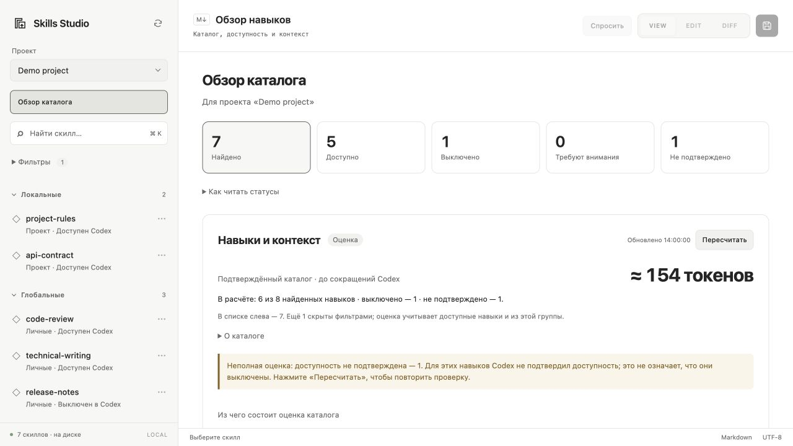

# Skills Studio

Панель контроля навыков Codex: доступность, источники, ручное ревью содержания и Markdown-редактор. Работает локально на macOS.

[Релизы](https://github.com/assurrussa/skills-studio/releases) · [Сообщить о проблеме](https://github.com/assurrussa/skills-studio/issues) · [Разработка](CONTRIBUTING.md) · [MIT](LICENSE)

## Quick Start

Нужны приложение Codex с поддержкой плагинов и установленный Codex CLI. Установка из GitHub:

Плагин использует встроенный Node.js приложения. Если при запуске не найден `node`, установите Node.js 20+.

```sh
codex plugin marketplace add assurrussa/skills-studio
codex plugin add skills-studio@personal-skills-studio
```

CLI скачает репозиторий и установит готовую сборку: запуск `npm install` для использования плагина не требуется. Имя marketplace — `personal-skills-studio`; оно сохранено для совместимости с прежними локальными установками. Формат GitHub-источника описан в [документации Codex](https://learn.chatgpt.com/docs/developer-commands#codex-plugin-marketplace).

1. Откройте Skills Studio через иконку в левой панели Codex. Если иконка не появилась, перезапустите приложение.
2. Выберите проект или «Только глобальные». Обзор показывает найденные, доступные, выключенные и требующие внимания навыки.
3. Откройте навык в режиме VIEW. В разделе «Сведения о навыке» находятся исходный путь, подключения и проверки.
4. Для изменений переключитесь в EDIT и сохраните текст кнопкой с дискетой или сочетанием ⌘/Ctrl+S.

Проверялось с Codex CLI `0.167.0-alpha.3.2` и Node.js 24. Плагин рассчитан на macOS; действия Finder и Terminal используют системные приложения.

### Обновление

```sh
codex plugin marketplace upgrade personal-skills-studio
codex plugin add skills-studio@personal-skills-studio
```

После обновления перезапустите Codex, если панель продолжает показывать прежнюю версию.

Если вы ранее подключали этот marketplace из локальной папки, его адрес уже занят локальным источником. Для перехода на GitHub выполните:

```sh
codex plugin marketplace remove personal-skills-studio
codex plugin marketplace add assurrussa/skills-studio
codex plugin add skills-studio@personal-skills-studio
```

## Интерфейс



На скриншоте — демонстрационный каталог, без пользовательских навыков и данных.

## Основные возможности

- Глобальные и локальные скиллы: поиск, фильтры, метки AgentSkill Skills и Git.
- Редактор Markdown с режимами VIEW / EDIT / DIFF; каждый навык открывается в VIEW.
- Копирование исходного пути и открытие папки навыка в Terminal.
- Переименование, копирование, перенос, включение, выключение и удаление скиллов.
- Отдельный чат для каждого скилла: выбор модели и усилия, обсуждение файла или выделенного текста.
- Резервные копии при сохранении и защита от перезаписи внешних изменений.
- Оценка контекста каталога с разбивкой по навыкам и отдельным размером полной инструкции.

## Контекст навыков

В «Обзоре каталога» блок «Навыки и контекст» показывает оценку объёма названий, описаний и путей доступных навыков. Разбивка отсортирована по вкладу в каталог; в ней есть поиск и отдельная колонка размера полного `SKILL.md`. По [документации Codex](https://learn.chatgpt.com/docs/build-skills), инструкции загружаются после выбора навыка, а дополнительные материалы — по необходимости.

Кнопка «Пересчитать» заново запрашивает доступность в Codex с `forceReload` и обновляет расчёт и время проверки. Пока запрос выполняется, предыдущая оценка остаётся на экране. Рядом показаны общее число найденных навыков, число учтённых, выключенных и неподтверждённых. Отдельная строка объясняет, сколько навыков скрыто фильтрами в списке слева.

Когда каталог включён в обращение к модели, он занимает место во входном контексте этого обращения. Контекст используется и при дальнейшей работе в чате, без добавления новой копии каталога в историю на каждое сообщение. Оценка в панели относится к каталогу до сокращений: Codex ограничивает стартовый список своим бюджетом, может сокращать описания и пропускать навыки. Поэтому это число не является фиксированной добавкой к каждому запросу или оценкой списания квоты. См. [загрузку навыков и бюджет каталога](https://learn.chatgpt.com/docs/build-skills).

Расчёт выполняется локально токенизатором `o200k_base` по реконструированным строкам каталога. Это оценка, а не телеметрия текущего запроса: модель, сокращение описаний, формат и состав каталога могут отличаться. Правила `AGENTS.md`, инструменты MCP и переписка не учитываются. Лимит контекста, процент его заполнения и расход тарифа плагину неизвестны; бюджет Antigravity в Codex не переносится.

Фильтры «скрывать» меняют только список: оценка включает скрытые системные и плагинные навыки. Выключенные, неподтверждённые и некорректные записи исключаются с указанием количества. Канонические ссылки на один файл учитываются один раз. При превышении безопасного объёма (128 КиБ) или сложности текста расчёт пропускается и показывается «не рассчитано». После сохранения навыка возврат в обзор пересчитывает оценку; для внешних изменений нажмите «Обновить».

Пояснения «О каталоге», «Как это влияет на запрос» и «Что именно посчитано» свёрнуты по умолчанию. Предупреждение о неполной оценке остаётся видимым. Карточки состояний фильтруют список; активный фильтр выделен.

## Скиллы

| Область | Где искать |
| --- | --- |
| Глобальные | `~/.agents/skills`, `$CODEX_HOME/skills` |
| Локальные | `.agents/skills`, `.codex/skills` выбранного проекта |

По умолчанию `$CODEX_HOME` — `~/.codex`. Проект выбирается вручную: привязки к последнему активному чату Codex нет.

- Поиск по названию, описанию и меткам — через строку поиска или ⌘/Ctrl+K.
- Переключатели видимости и состояния собраны в раскрываемом блоке «Фильтры» под поиском; рядом показано количество активных фильтров.
- Нажатие на заголовок раздела сворачивает его.
- Системные навыки по умолчанию скрыты; навыки плагинов видны. Их фильтры независимы. Плагинные навыки сгруппированы по плагину.
- Системные скиллы и оригиналы из плагинов доступны только для чтения. Для редактирования сделайте копию.

Метка AgentSkill Skills означает запись в `skills.lock.toml`. Метка Git — файл `SKILL.md` или ссылка на каталог скилла добавлены в индекс Git.

## Доступность и актуальность

Доступность проверяется отдельным Codex App Server для выбранного проекта. Состояние «Только в кэше» не означает установленный или доступный навык. При недоступности Codex каталог файлов остаётся виден со статусом «не проверено». Это сведения для выбранного проекта, а не список навыков, загруженных в конкретный чат. Кнопка обновления перечитывает состояние; обычные операции используют короткий кэш.

Карточка показывает исходный файл и все найденные подключения. Сохранение навыка через символьную ссылку изменяет оригинал, например файл общего Git-репозитория. Если Codex сообщает исходный путь вместо личной символьной ссылки, переключатель использует подтверждённый путь; карточка объясняет, к какому файлу применяется настройка. Навыки, найденные только через runtime за пределами обычных каталогов, доступны для чтения.

«Проверить источник» вручную сравнивает каталог Git-навыка в локальном HEAD с текущей upstream-веткой. Проверка использует отдельный временный bare-репозиторий, не обновляет рабочую копию, индекс или refs исходника. Локальные правки показываются отдельно. Без upstream, доступа к источнику или подтверждённой доступной версии плагина актуальность остаётся неизвестной. Проверки не устанавливают обновления.

Ревью содержания фиксируется вручную: комментарий, ссылки на основания и дата. Оно связано с отпечатком всего пакета, включая ресурсы и содержимое ссылок. После изменения пакета нужен повторный просмотр. Автоматические проверки находят ошибки метаданных, отсутствующие Markdown-ссылки на локальные файлы, одинаковые имена и идентичные пакеты; они не подтверждают смысловую корректность инструкций.

Перед проверкой или фиксацией ревью сохраните правки. Для пакетов более 2000 записей, 16 МиБ или глубины 32 и при ошибках чтения полный отпечаток не формируется — подтвердить ревью нельзя. Результаты проверок хранятся локально в `skills-studio/health/` внутри `$CODEX_HOME`.

## Редактор

| Режим | Для чего |
| --- | --- |
| VIEW | Просмотр отформатированного текста, включая несохранённые правки; режим по умолчанию |
| EDIT | Редактирование Markdown с подсветкой синтаксиса |
| DIFF | Сравнение с последней загруженной или сохранённой версией: зелёные добавления и красные удаления |

DIFF работает и вне Git-репозитория. Сохранение проверяет метаданные скилла, создаёт резервную копию и обнаруживает внешние изменения файла.

При конфликте несохранённый текст остаётся в редакторе. Скопируйте его, если нужно, и перечитайте файл кнопкой ↻ в списке скиллов.

Перед закрытием плагина сохраните правки.

Рядом с путём файла кнопка «Путь» копирует полный путь к оригиналу `SKILL.md`, а «Терминал» открывает его папку в Terminal на macOS. Для символьной ссылки используется исходный файл. Действия доступны и для системных навыков и навыков плагинов, не сохраняют правки и не меняют файлы. Отдельного каталога правил `AGENTS.md` в панели пока нет.

## Управление скиллами

В меню ⋯ или по правому клику доступны переименование, копирование, перенос между глобальной и локальной областями, открытие в Finder, включение, выключение и удаление.

Включение и выключение обычного навыка меняет настройку Codex через `skills/config/write`; файл и символьные ссылки остаются на месте. При нескольких подключениях выбирайте конкретное подключение в карточке. Записи из прежних `disabled-skills` остаются видимыми; действие «Восстановить из архива» явно возвращает их в `skills`.

Удаление запрашивает подтверждение и сохраняет папку в архиве. Эти действия не меняют `skills.lock.toml` и не создают Git-коммиты.

## Помощник

Кнопка «Спросить» открывает чат справа от редактора. Для вопроса о фрагменте выделите текст и выберите «Спросить в боковом чате» в контекстном меню.

Текст передаётся модели только вместе с отправленным вопросом: исходная, последняя сохранённая и текущая версии файла, а также выделенный фрагмент, если он есть. Правки из ответа пользователь переносит в редактор самостоятельно.

- Модель и усилие выбираются под полем ввода. Режим «Авто» использует настройку усилия Codex, если модель её поддерживает, иначе — значение модели по умолчанию.
- У каждого скилла своя переписка, черновик и настройки. Они хранятся **до закрытия или перезагрузки плагина**. При переключении скиллов ответы продолжают генерироваться в фоне.
- Enter отправляет вопрос, Shift+Enter добавляет строку. Кнопки остановки и нового разговора действуют на текущий чат.

Плагин сам запускает Codex App Server. Для авторизации нажмите «Войти через ChatGPT» в боковой панели, если появится запрос. Доступ к моделям и лимиты определяются вашей учётной записью Codex. Если Codex настроен на API key, используется тарификация его провайдера.

## Данные и восстановление

У плагина нет аналитики и удалённого хранилища документов. Настройки, резервные копии и архивы лежат локально в `$CODEX_HOME/skills-studio/`:

| Каталог или файл | Содержимое |
| --- | --- |
| `preferences.json` | Выбранный проект, фильтр и свёрнутые разделы |
| `backups/` | Предыдущие версии файлов перед сохранением |
| `deleted/` | Архивы удалённых и перенесённых папок; исходный путь записан в `origin.json` |

## Разработка

В клонированном репозитории:

```sh
git clone https://github.com/assurrussa/skills-studio.git
cd skills-studio
cd plugins/skills-studio
npm ci
npm test
npm run check
```

Собрать плагин: `npm run build`.

Результат — `server.mjs` и `assets/app.html` внутри каталога плагина.

Для установки своей сборки выполните из корня репозитория:

```sh
codex plugin marketplace add "$PWD"
codex plugin add skills-studio@personal-skills-studio
```

Порядок подготовки изменений описан в [CONTRIBUTING.md](CONTRIBUTING.md).

Лицензия — [MIT](LICENSE). [Лицензии зависимостей](plugins/skills-studio/THIRD_PARTY_NOTICES.txt).
