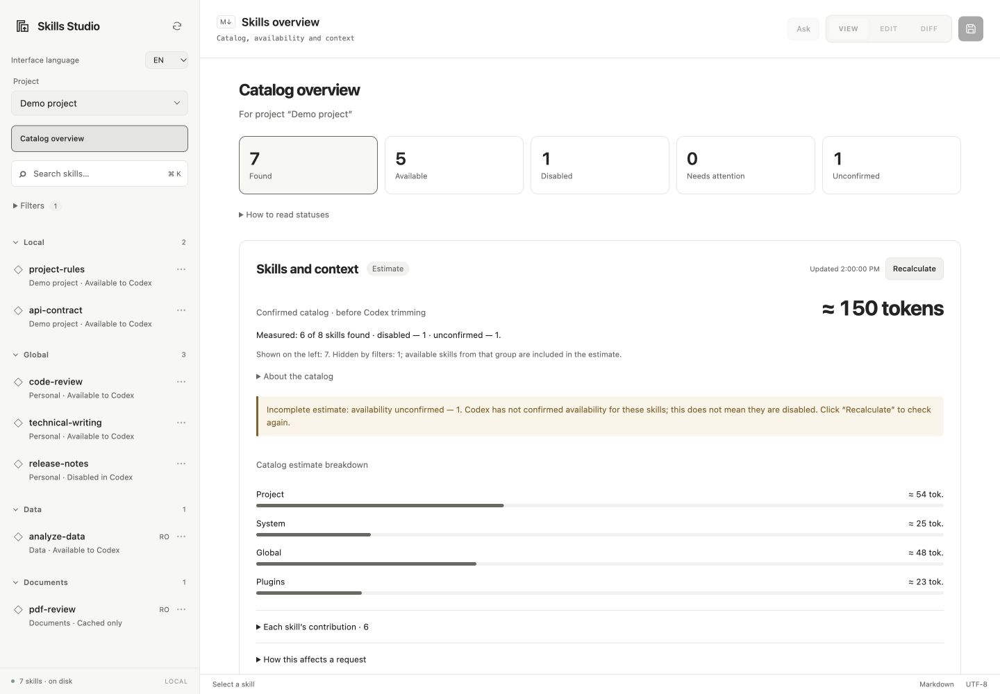

# Skills Studio

**English** | [Русский](README.ru.md)

[](https://github.com/assurrussa/skills-studio/releases)
[](LICENSE)


A local Codex plugin for managing skills: availability checks, source freshness, content reviews, context estimates, and a Markdown editor. Runs on macOS.

[Releases](https://github.com/assurrussa/skills-studio/releases) · [Report an issue](https://github.com/assurrussa/skills-studio/issues) · [Contributing](CONTRIBUTING.md)

## Quick start

You need the Codex app with plugin support and the Codex CLI. Install from GitHub:

```sh
codex plugin marketplace add assurrussa/skills-studio
codex plugin add skills-studio@personal-skills-studio
```

The CLI downloads the repository and installs the prebuilt plugin. No `npm install` is needed to use it. The marketplace name remains `personal-skills-studio` for compatibility with earlier local installations. See the [Codex marketplace documentation](https://learn.chatgpt.com/docs/developer-commands#codex-plugin-marketplace).

The plugin uses the app's bundled Node.js when available. If startup reports that `node` is missing, install Node.js 20+.

1. Open Skills Studio from the Codex sidebar. Restart the app if the icon does not appear.
2. Choose a project or **Global only**. The overview shows found, available, disabled, and unconfirmed skills, plus skills that need attention.
3. Open a skill in **VIEW**. Expand **Skill details** to inspect its original path, registrations, and checks.
4. Switch to **EDIT** and save with the save button or ⌘/Ctrl+S.

Tested with Codex CLI `0.167.0-alpha.3.2` and Node.js 24. Finder and Terminal actions use macOS system apps.

### Updates

```sh
codex plugin marketplace upgrade personal-skills-studio
codex plugin add skills-studio@personal-skills-studio
```

Restart Codex after updating if the panel still shows the previous version.

If you previously added this marketplace from a local directory, switch its source to GitHub:

```sh
codex plugin marketplace remove personal-skills-studio
codex plugin marketplace add assurrussa/skills-studio
codex plugin add skills-studio@personal-skills-studio
```

## Interface language

Skills Studio starts in **English** by default. Use **EN / RU** in the sidebar to switch languages. The choice is stored locally and restored when you reopen the plugin. Switching languages preserves unsaved edits, filters, and chat drafts; skill content and conversation messages keep their original language.

## Preview



The screenshot uses demonstration data, without personal skills or workspace information.

## Features

- Global, project, and plugin skills with search, visibility filters, AgentSkill Skills labels, and Git tracking.
- Markdown editing with **VIEW / EDIT / DIFF**. Every skill opens in VIEW.
- Copy the original file path or open its directory in Terminal.
- Rename, copy, move, enable, disable, and archive skills.
- A separate chat for each skill, with model and reasoning-effort controls.
- Backups on save and protection against overwriting external changes.
- Context estimates by skill, with a separate estimate for the full instruction file.

## Skills and context

The **Skills and context** card estimates the token count of names, descriptions, and file paths for skills with confirmed availability. The breakdown is sorted by catalog contribution and includes search and a separate column for the full `SKILL.md`. Codex loads full instructions when it selects a skill and additional resources as needed. See [how Codex uses skills](https://learn.chatgpt.com/docs/build-skills).

**Recalculate** requests fresh availability data from Codex with `forceReload`, updates the estimate, and records the check time. The previous estimate stays visible while the request runs. Coverage shows how many skills were included, disabled, or left unconfirmed, and explains differences from the filtered sidebar.

When a catalog is included in a model request, it occupies input context for that request. The context is reused during subsequent work in the chat; a new catalog copy is not appended to the conversation for every message. The panel estimates the catalog **before shortening**: Codex applies its own initial-list budget and may shorten descriptions or omit skills. This figure is not a fixed addition to every request or a measure of subscription usage.

The calculation runs locally with `o200k_base` over reconstructed catalog entries. The actual model, tokenizer, entry format, and available skills may differ. `AGENTS.md` rules, MCP tools, conversation history, and other context are excluded. The plugin does not know the active chat's context limit or billing usage, and Antigravity's budget is not a Codex limit.

Visibility filters affect the sidebar only. The estimate includes available system and plugin skills even when hidden. Disabled, unconfirmed, and invalid entries are excluded with counts. Aliases of the same canonical file are counted once. If text exceeds the safe size limit (128 KiB) or tokenization complexity limit, the result is shown as unavailable. Saving a skill invalidates the estimate; returning to the overview recalculates it. Use refresh for external changes.

Catalogue help, request impact, and calculation details are collapsed by default. Incomplete-estimate warnings remain visible. Status cards filter the sidebar and highlight the active filter.

## Skill locations

| Scope | Locations |
| --- | --- |
| Global | `~/.agents/skills`, `$CODEX_HOME/skills` |
| Project | `.agents/skills`, `.codex/skills` in the selected project |

`$CODEX_HOME` defaults to `~/.codex`. Select the project manually; Skills Studio does not follow the last active Codex chat.

- Search names, descriptions, and labels with the search field or ⌘/Ctrl+K.
- Expand **Filters** to change visibility and availability filters. The badge shows the number of active filters.
- Click a section heading to collapse or expand it.
- System skills are hidden by default; plugin skills are visible and grouped by plugin. The two visibility controls are independent.
- System skills and plugin originals are read-only. Make a copy to edit them.

The **AgentSkill Skills** label identifies an entry in `skills.lock.toml`. **Git** means the `SKILL.md` file or its directory symlink is tracked by Git.

## Availability, source freshness, and reviews

Availability is checked through a separate Codex App Server for the selected project. Files found in a plugin cache do not prove that a skill is installed or available. If Codex cannot be reached, the file catalog remains visible with unconfirmed status. These checks describe the selected project, not the exact skills loaded in the current chat. Refresh rereads availability; ordinary operations use a short cache.

Skill details show the original file and all discovered registrations. Saving through a symlink changes its original file, which may belong to a shared Git repository. When Codex reports the canonical path instead of a personal symlink, availability controls use the confirmed path. Skills discovered only through runtime outside the usual locations are read-only.

**Check source** compares a Git skill's directory at local HEAD with the current upstream branch. It uses a separate temporary bare repository and does not update the source checkout, index, or refs. Local edits are reported separately. Without an upstream, source access, or a confirmed plugin version, freshness remains unknown. These checks do not install updates.

Content reviews are recorded manually with a note, evidence links, and a date. A review is tied to a fingerprint of the whole package, including resources and symlink contents. Package changes require another review. Automated checks detect invalid metadata, missing local Markdown links, duplicate names, and identical packages; they do not establish that the instructions are semantically correct.

Save edits before checking a source or recording a review. A complete fingerprint is not produced for packages exceeding 2,000 entries, 16 MiB, or depth 32, or when files cannot be read. Such a package cannot be marked reviewed. Check results are stored locally under `$CODEX_HOME/skills-studio/health/`.

## Editor

| Mode | Purpose |
| --- | --- |
| VIEW | Render Markdown, including unsaved edits; the default mode |
| EDIT | Edit Markdown with syntax highlighting |
| DIFF | Compare with the last loaded or saved version; green additions and red deletions |

DIFF also works outside Git repositories. Saving validates skill metadata, creates a backup, and detects external file changes. On conflict, unsaved text stays in the editor. Copy it if needed before refreshing the skill list. Save your edits before closing the plugin.

**Path** copies the canonical `SKILL.md` path. **Terminal** opens its containing directory on macOS. Both work for system and plugin skills as well, without saving edits or changing files. A separate `AGENTS.md` rules catalog is not included.

## Skill management

The ⋯ menu and context menu provide rename, copy, move between global and project scope, reveal in Finder, enable, disable, and delete actions.

Enabling or disabling a personal skill updates Codex through `skills/config/write`; files and symlinks stay in place. If there are multiple registrations, choose the relevant one in skill details. Entries in the legacy `disabled-skills` directory remain visible; **Restore from archive** explicitly moves them back to `skills`.

Deleting a skill asks for confirmation and archives its directory. Management actions do not update `skills.lock.toml` or create Git commits.

## Assistant

**Ask** opens a chat beside the editor. To ask about a fragment, select text and choose **Ask in side chat** from its context menu.

When you send a question, the assistant receives the original, last saved, and current editor versions, plus the selected fragment if present. Apply suggested edits yourself in the editor.

- Choose the model and reasoning effort below the input field. **Auto** uses the Codex effort setting when supported, otherwise the model default.
- Each skill has its own conversation, draft, and settings. They last **until the plugin is closed or reloaded**. Replies continue in the background when you switch skills.
- Enter sends; Shift+Enter adds a line. Stop and new-conversation controls apply to the active chat.

The plugin starts a local Codex App Server. Use **Sign in with ChatGPT** if prompted in the assistant panel. Model access and limits follow your Codex account. If Codex uses an API key, the configured provider's pricing applies.

## Local data and recovery

The plugin has no analytics or remote document storage. Preferences, backups, and archives are stored in `$CODEX_HOME/skills-studio/`:

| Path | Contents |
| --- | --- |
| `preferences.json` | Interface language, selected project, filters, and collapsed sections |
| `backups/` | Previous file versions saved before writes |
| `deleted/` | Archived directories; original paths are recorded in `origin.json` |

## Development

```sh
git clone https://github.com/assurrussa/skills-studio.git
cd skills-studio/plugins/skills-studio
npm ci
npm test
npm run check
```

Build with `npm run build`. The output is `server.mjs` and `assets/app.html` inside the plugin directory. To install your build, run from the repository root:

```sh
codex plugin marketplace add "$PWD"
codex plugin add skills-studio@personal-skills-studio
```

See [CONTRIBUTING.md](CONTRIBUTING.md) for the contribution workflow.

Licensed under [MIT](LICENSE). See [third-party notices](plugins/skills-studio/THIRD_PARTY_NOTICES.txt) for bundled dependency licenses.
